<!-- 1. 헤더: 라이트/다크 모드에 따라 자동 전환 -->
<picture>
  <source media="(prefers-color-scheme: dark)" srcset="./profile/assets/header-dark.svg">
  
</picture>

<!-- 2. 링크: 배지 대신 텍스트 + 가운뎃점 -->
<a href="https://your-site.com">Website</a>&nbsp;&nbsp;·&nbsp;&nbsp;<a href="https://www.linkedin.com/in/your-id">LinkedIn</a>&nbsp;&nbsp;·&nbsp;&nbsp;<a href="mailto:you@example.com">Email</a>

   

<!-- 3. 기술 스택: i= 뒤에 본인 스택만 (5~8개 권장). 목록: https://skillicons.dev -->
<picture>
  <source media="(prefers-color-scheme: dark)" srcset="https://skillicons.dev/icons?i=swift,ts,react,nodejs,figma,git&theme=dark">
  
</picture>

   

<!-- 4. 통계 카드: .github/workflows/readme-cards.yml 이 매일 생성 -->
<picture>
  <source media="(prefers-color-scheme: dark)" srcset="./profile/stats-dark.svg">
  
</picture>
<picture>
  <source media="(prefers-color-scheme: dark)" srcset="./profile/top-langs-dark.svg">
  
</picture>

